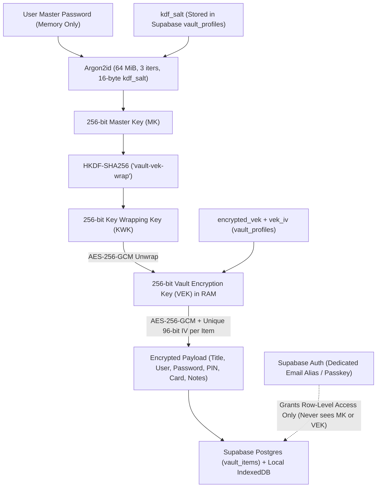
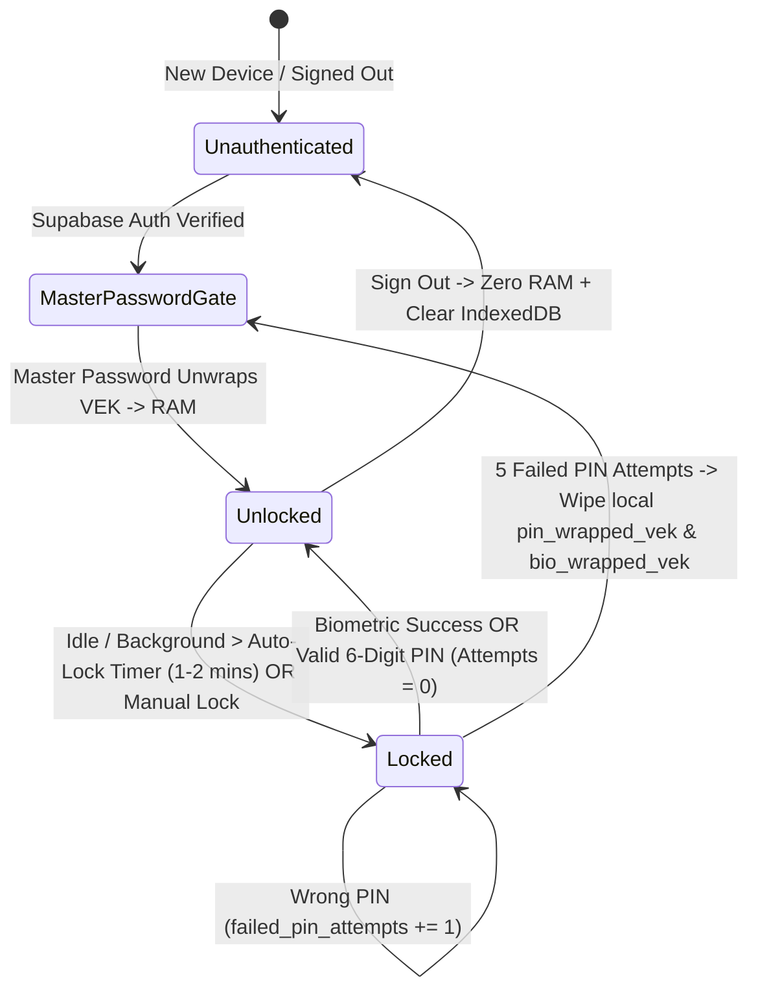

# Personal Zero-Knowledge Password & PIN Manager — Project Blueprint

> **Architecture:** Mobile-First Installable PWA + Companion Browser Extension  
> **Security Model:** Zero-Knowledge Client-Side E2EE (`Argon2id` + `HKDF-SHA256` + `AES-256-GCM` + WebAuthn Biometrics & 6-Digit Quick-Unlock PIN)  
> **Sync & Storage:** Offline-First `IndexedDB` (`Dexie.js`) + `Supabase` Encrypted Ciphertext Sync  
> **Design Language:** Deep Obsidian Dark Mode (`#09090B`) with Electric Purple Accents (`#8B5CF6`) & Minimalist Modern Typography

---

## 1. Project Overview & Problem Statement

### 1.1 The Problem
Over several years, critical personal credentials—logins, bank/ATM PINs, device passcodes, payment cards, and recovery notes—have accumulated across scattered `.txt` files and unstructured Google Keep notes. This creates three severe friction and security risks:
1. **Fragmentation:** Finding a credential across devices requires manually digging through disconnected notes and local files.
2. **Plaintext Exposure:** `.txt` files and standard cloud notes store secrets unencrypted; any device compromise, synced folder leak, or account breach exposes everything immediately.
3. **Device Lock-In:** Desktop text files aren't easily usable on mobile with autofill or quick copy, and copying secrets leaves them lingering indefinitely in the OS clipboard.

### 1.2 The Solution
A unified, personal **Zero-Knowledge Encrypted Vault** built as an **Installable Mobile-First Progressive Web App (PWA)** paired with a **Companion Browser Extension**, synchronized across every phone, tablet, and desktop via **Supabase**.

### 1.3 Core Architectural Pillars
1. **Zero-Knowledge End-to-End Encryption (E2EE):**
   - All key derivation, encryption, and decryption run strictly on-device in volatile JavaScript memory using `Argon2id` and the native `Web Crypto API` (`AES-256-GCM`).
   - Supabase acts purely as a dumb, zero-knowledge ciphertext relay and auth boundary. Even with full database access, nobody (including Supabase or a DB attacker) can read titles, usernames, PINs, URLs, or notes.
2. **Frictionless Daily Unlock (PIN + FaceID / Fingerprint):**
   - Your **Master Password** is only needed when trusting a new device or recovering after a brute-force lockout.
   - Every time you open the app, you unlock effortlessly via **Device Biometrics (FaceID / TouchID / Android Fingerprint / Windows Hello via WebAuthn)** or a **6-digit Quick-Unlock PIN**.
   - Auto-locks automatically after **1–2 minutes** in the background (configurable) and wipes local unlock keys after **5 consecutive failed PIN attempts**.
3. **Smart Local `.txt` & Keep Note Importer:**
   - A 100% client-side heuristic/regex parser and interactive **Staging Inbox** that ingests unstructured `.txt`/`.md` files, Google Takeout Keep `.json`/`.html` exports, and raw pasted text—automatically classifying Logins, PINs, Cards, and Notes without ever sending plaintext to any external AI or server.
4. **Mobile-First Minimalist Dark UI:**
   - Designed primarily for one-handed thumb navigation on mobile, with a responsive 3-column split view and `Cmd/Ctrl + K` command palette on desktop, styled in obsidian dark tones with electric purple accents.

---

## 2. System Architecture & Monorepo Structure

### 2.1 Tech Stack

| Layer | Technology Choice | Purpose & Rationale |
| :--- | :--- | :--- |
| **Monorepo** | `pnpm` Workspaces (+ optional Turborepo) | Shares cryptographic engine, sync logic, schemas, and UI components cleanly across PWA and Extension. |
| **Mobile & Desktop PWA** | React 19 + TypeScript + Vite + `vite-plugin-pwa` | Instant offline-capable web app installable to iOS/Android Home Screens and desktop OS docks with zero App Store gatekeeping. |
| **Browser Extension** | WXT (Manifest V3) + React + TypeScript | Unified extension build targeting Chrome, Brave, Edge, and Firefox with domain matching and inline autofill. |
| **Cryptography** | Web Crypto API + `hash-wasm` (`Argon2id`) | Hardware-accelerated `AES-256-GCM`, `HKDF-SHA256`, `PBKDF2`, `CSPRNG`, plus WebAuthn (`navigator.credentials`) for biometrics. |
| **Local Storage** | `Dexie.js` (IndexedDB) | Encrypted offline-first vault storage, sync queue, and local device-wrapped unlock keys. |
| **State & Sync** | Zustand + TanStack Query | Reactive in-memory decrypted vault state (wiped on lock) + background delta synchronization. |
| **UI & Styling** | Tailwind CSS v4 + Radix UI / Shadcn Primitives | Accessible bottom sheets, dialogs, command palette, custom PIN pad, and dark/purple theme tokens. |
| **Backend & Auth** | Supabase (PostgreSQL + RLS + Supabase Auth) | Email-alias / Passkey authentication and Row-Level-Secured encrypted item storage. |

### 2.2 Monorepo Directory Tree

```text
password-manager/
├── package.json
├── pnpm-workspace.yaml
├── turbo.json
├── BLUEPRINT.md
├── apps/
│   ├── pwa/                               # Mobile-first installable PWA
│   │   ├── index.html
│   │   ├── vite.config.ts                 # Includes vite-plugin-pwa & Workbox offline cache
│   │   ├── public/
│   │   │   ├── manifest.webmanifest
│   │   │   └── icons/                     # 192x192, 512x512, maskable, Apple touch icons
│   │   └── src/
│   │       ├── main.tsx
│   │       ├── App.tsx
│   │       ├── routes/
│   │       │   ├── AuthRoute.tsx          # Email Alias / Passkey login + Master Password onboarding
│   │       │   ├── VaultRoute.tsx         # Mobile list + Desktop 3-pane inspector
│   │       │   ├── PinsRoute.tsx          # Dedicated quick-access PINs view
│   │       │   ├── GeneratorRoute.tsx     # Password, Diceware passphrase, and PIN generator
│   │       │   ├── ImportRoute.tsx        # Smart .txt / Keep Notes Staging Inbox
│   │       │   └── SettingsRoute.tsx      # Biometrics, PIN, auto-lock timer, .vault backup export
│   │       └── components/
│   │           ├── LockOverlay.tsx        # Full-screen Biometric + 6-digit PIN keypad
│   │           ├── ItemBottomSheet.tsx    # Mobile thumb-friendly item viewer/editor
│   │           ├── CommandPalette.tsx     # Desktop Ctrl/Cmd+K quick search & copy
│   │           └── ClipboardToast.tsx     # 30-second countdown + auto-clear indicator
│   └── extension/                         # WXT Manifest V3 Companion Extension
│       ├── wxt.config.ts
│       └── entrypoints/
│           ├── background.ts              # Service worker: session timeout, tab URL matching, autofill relay
│           ├── content.ts                 # Detects login/password inputs, renders inline fill icon
│           └── popup/
│               ├── index.html
│               ├── main.tsx
│               └── PopupApp.tsx           # 360x520 dark/purple popup reusing @vault/ui & @vault/core
├── packages/
│   ├── crypto/                            # Pure zero-knowledge cryptographic primitives
│   │   ├── package.json
│   │   └── src/
│   │       ├── index.ts
│   │       ├── kdf.ts                     # Argon2id + PBKDF2-SHA256 fallback
│   │       ├── hkdf.ts                    # Subkey derivation & VEK wrapping/unwrapping
│   │       ├── cipher.ts                  # AES-256-GCM encrypt/decrypt with random 96-bit IV
│   │       ├── webauthn.ts                # Biometric PRF / platform-bound key unwrap helpers
│   │       ├── generator.ts               # CSPRNG password, Diceware, and PIN generator
│   │       ├── memory.ts                  # Uint8Array zeroization helpers
│   │       └── __tests__/                 # Deterministic crypto round-trip & tamper tests
│   ├── core/                              # Shared domain schemas, offline DB, sync, & parser
│   │   ├── package.json
│   │   └── src/
│   │       ├── types/
│   │       │   └── vault.ts               # DecryptedVaultItem union & EncryptedVaultRow types
│   │       ├── db/
│   │       │   └── dexie.ts               # IndexedDB schema (items, profile, syncQueue, deviceKeys)
│   │       ├── sync/
│   │       │   ├── supabaseClient.ts
│   │       │   └── deltaSync.ts           # Offline-first push/pull delta sync & conflict handling
│   │       ├── store/
│   │       │   ├── useVaultStore.ts       # Volatile decrypted state + auto-lock timer manager
│   │       │   └── useAuthStore.ts        # Auth & device trust state
│   │       ├── importer/
│   │       │   ├── blockSplitter.ts       # Splits raw .txt / Keep notes into candidate records
│   │       │   ├── classifiers.ts         # Regex/heuristics for PINs, Logins, Cards, Notes
│   │       │   ├── keepParser.ts          # Google Takeout Keep JSON/HTML adapter
│   │       │   └── __tests__/             # Unit tests with messy real-world .txt fixtures
│   │       └── backup/
│   │           ├── vaultExport.ts         # 1-click encrypted .vault file generator
│   │           └── vaultImport.ts         # Decrypts & restores standalone .vault backup
│   └── ui/                                # Shared React UI primitives & design tokens
│       ├── package.json
│       └── src/
│           ├── styles/tokens.css          # Obsidian dark + electric purple CSS variables
│           ├── components/
│           │   ├── PinKeypad.tsx          # Tactile 0-9 + biometric button keypad
│           │   ├── SecretDisplay.tsx      # Syntax-highlighted JetBrains Mono secret viewer
│           │   ├── CategoryBadge.tsx
│           │   └── CopyButton.tsx         # 1-tap copy triggering 30s clipboard timer
└── supabase/
    └── migrations/
        └── 202611150001_init_vault.sql    # PostgreSQL schema + RLS policies
```

---

## 3. Zero-Knowledge Cryptographic Architecture

### 3.1 Email vs. Email-Free Sync Strategy (Why Your Email Doesn't Expose Your Vault)
Using your main email vs. an alias affects **account discovery and auth recovery**, not vault confidentiality—provided authentication and encryption keys are strictly separated:
- **Recommended Account Strategy:** Sign up in Supabase Auth using a **dedicated email alias** (e.g., `yourname+vault@gmail.com` or a SimpleLogin/Proton alias) or a **Passkey**, keeping your vault login decoupled from public logins while still receiving security/login notifications or magic links on your real inbox.
- **Strict Auth/Encryption Separation:** Your Supabase login (email/magic-link or auth password) only proves to Supabase that you own row `user_id`. **Never** send your Master Password—or anything derived from it—to Supabase Auth. Even if your email inbox and Supabase database were compromised simultaneously, an attacker only obtains ciphertext encrypted under your separate **Master Password**.

### 3.2 Key Hierarchy & Derivation Pipeline

1. **Master Password & Salt:**
   - On initial setup, the client generates a cryptographically random 128-bit `kdf_salt` (`crypto.getRandomValues(new Uint8Array(16))`) and stores the public salt + KDF parameters in `vault_profiles`.
2. **Key Derivation (`Argon2id` + `PBKDF2` fallback):**
   - On-device, `Master Password + kdf_salt` passes through **Argon2id** (recommended baseline: `memory = 64 MiB (65536 KiB)`, `iterations = 3`, `parallelism = 1`, `hashLength = 32 bytes`) via `hash-wasm`.
   - If a constrained browser environment cannot execute WASM Argon2id, fall back strictly to `PBKDF2-HMAC-SHA256` at `600,000` iterations (recorded in `vault_profiles.kdf_algorithm` so all devices derive identically).
   - Output: 256-bit **`Master Key (MK)`**.
3. **HKDF Subkey Splitting & Vault Encryption Key (VEK) Wrapping:**
   - Using `HKDF-SHA256` on `MK`, derive a dedicated 256-bit `Key Wrapping Key (KWK)`.
   - On vault creation, generate a completely random 256-bit **`Vault Encryption Key (VEK)`** (`crypto.getRandomValues(new Uint8Array(32))`).
   - Encrypt the `VEK` using `KWK` (`AES-256-GCM`) to produce `encrypted_vek` + `vek_iv`, stored in `vault_profiles`.
   - **Why wrap a random VEK instead of encrypting items directly with the Master Key?** If you ever change your Master Password, you only decrypt and re-wrap the single 32-byte `VEK`—avoiding expensive re-encryption and version conflicts across hundreds of synced vault items.
4. **Per-Item `AES-256-GCM` Encryption:**
   - Every vault item (title, category, username, email, password, PIN, card number, CVV, URLs, notes) is serialized to a UTF-8 JSON string and encrypted with the `VEK` using `AES-256-GCM` and a fresh random **96-bit IV** (`12 bytes`) per save/edit.
   - Database rows only expose non-sensitive sync metadata (`id`, `user_id`, `version`, `is_favorite`, `deleted_at`, `updated_at`).



---

## 4. Daily Unlock Security: PIN, FaceID / Fingerprint, & Auto-Lock Lifecycle

Typing a long Master Password on a phone keyboard multiple times a day creates friction that drives users back to insecure notes. The vault solves this with **Tiered Device Trust**:

### 4.1 First-Time Device Enrollment
1. Sign into Supabase Auth on the new phone or desktop browser (using your email alias magic link / OTP / passkey).
2. Enter your **Master Password** once to derive `MK` → `KWK` and unwrap the `VEK` in memory.
3. Choose how to protect quick daily opens on this device:
   - **6-Digit Quick-Unlock PIN** (Required fallback / primary PIN lock).
   - **Device Biometrics** (FaceID, TouchID, Android Fingerprint, or Windows Hello).

### 4.2 Local Key Wrapping Mechanics

| Unlock Method | Cryptographic Storage & Execution | Security Property |
| :--- | :--- | :--- |
| **6-Digit Quick-Unlock PIN** | Client generates a random 128-bit `device_pin_salt`. Runs `Argon2id` (or `PBKDF2-SHA256` 310k iters) on `PIN + device_pin_salt` to derive `PIN_KEK`, then encrypts the `VEK` (`AES-256-GCM`) into IndexedDB (`device_keys.pin_wrapped_vek`). | The PIN never leaves the device and cannot decrypt Supabase ciphertext on another device without the local `device_keys` record. |
| **Biometrics (WebAuthn)** | Uses `navigator.credentials.create()` with `authenticatorSelection: { authenticatorAttachment: "platform", userVerification: "required" }`. <br>• **Primary Path (WebAuthn PRF Extension):** Derives a hardware-backed 256-bit key directly from the WebAuthn assertion (`extensions: { prf }`) to unwrap `bio_wrapped_vek`.<br>• **Fallback Path (Non-PRF Safari/older devices):** Generates a non-extractable `CryptoKey` in IndexedDB gated behind a verified WebAuthn `userVerification: "required"` assertion check before unwrapping. | Hardware-enforced biometric prompt (FaceID / Fingerprint / Windows Hello) is required every time before the `VEK` enters RAM. |

### 4.3 Auto-Lock & Brute-Force State Machine



- **Strict Volatile Memory Handling:** The raw `VEK` (`Uint8Array` / non-extractable `CryptoKey`) and all decrypted `DecryptedVaultItem[]` objects live **only inside the JavaScript heap** (Zustand store). They are **never** written to `localStorage`, `sessionStorage`, cookies, or unencrypted IndexedDB tables.
- **Auto-Lock Listeners:**
  - Tracks `document.visibilitychange` (`hidden`), `window.blur`, and user interaction events (`pointerdown`, `keydown`, `scroll`).
  - Default timeout: **2 minutes** (user-configurable options: `Immediate (0s)`, `1 minute`, `2 minutes`, `5 minutes`).
  - Upon timeout or clicking **Lock Vault**, immediately overwrite byte arrays (`vekBytes.fill(0)`), reset Zustand decrypted state to `[]`, and render `<LockOverlay />`.
  - In `apps/extension`, the MV3 background service worker tracks idle time via `chrome.idle` / alarm timers and clears its in-memory session key on timeout or browser shutdown.
- **5-Strike Local Key Wipe:**
  - Every failed 6-digit PIN attempt increments `failed_pin_attempts` persisted in `IndexedDB`.
  - Reaching **5 consecutive failures** immediately deletes `pin_wrapped_vek` and `bio_wrapped_vek` from `IndexedDB` and forces a full **Master Password** re-entry to re-trust the device.

---

## 5. Vault Item Schemas & Core Features

### 5.1 TypeScript Data Contracts (`packages/core/src/types/vault.ts`)

```typescript
export type VaultCategory = 'login' | 'pin' | 'card' | 'note';

export type PinType =
  | 'bank_atm'
  | 'device_phone'
  | 'sim_puk'
  | 'door_alarm'
  | 'gov_work_id'
  | 'other';

export interface PasswordHistoryEntry {
  password: string;
  changedAt: string; // ISO-8601
}

export interface VaultItemBase {
  id: string;          // UUID v4
  category: VaultCategory;
  title: string;
  isFavorite: boolean;
  tags: string[];
  createdAt: string;   // ISO-8601
  updatedAt: string;   // ISO-8601
}

export interface LoginItem extends VaultItemBase {
  category: 'login';
  username?: string;
  email?: string;
  password: string;
  urls: string[];      // Used by extension & favicon resolver
  notes?: string;
  passwordHistory: PasswordHistoryEntry[];
}

export interface PinItem extends VaultItemBase {
  category: 'pin';
  pinCode: string;     // Stored as string to preserve leading zeros (e.g., "0482")
  pinType: PinType;
  associatedAccount?: string;
  notes?: string;
}

export interface CardItem extends VaultItemBase {
  category: 'card';
  cardholderName: string;
  cardNumber: string;
  brand?: string;      // e.g., "Visa", "Mastercard", "Amex"
  expiryMonth: string; // "01" - "12"
  expiryYear: string;  // "2028"
  cvv: string;
  cardPin?: string;
  billingZip?: string;
  notes?: string;
}

export interface RecoveryCodeEntry {
  code: string;
  used: boolean;
}

export interface NoteItem extends VaultItemBase {
  category: 'note';
  content: string;     // Markdown / free-form text
  recoveryCodes?: RecoveryCodeEntry[];
}

export type DecryptedVaultItem = LoginItem | PinItem | CardItem | NoteItem;

/** Encrypted record stored in IndexedDB & synced to Supabase */
export interface EncryptedVaultRow {
  id: string;
  user_id: string;
  encrypted_payload: string; // Base64 AES-256-GCM ciphertext + tag
  iv: string;                // Base64 96-bit IV
  version: number;           // Optimistic concurrency counter
  is_favorite: boolean;      // Optional unencrypted flag for fast filter/pinning
  deleted_at: string | null; // Soft-delete tombstone for cross-device sync
  created_at: string;
  updated_at: string;
}
```

### 5.2 Cryptographically Secure Password & PIN Generator
All randomness uses `crypto.getRandomValues()` with rejection sampling (eliminating modulo bias):
1. **Random Password Mode:**
   - Length slider: `8` to `64` characters (default `20`).
   - Character sets: Uppercase (`A-Z`), Lowercase (`a-z`), Numbers (`0-9`), Symbols (`!@#$%^&*-_=+?`).
   - Toggle: **Exclude ambiguous characters** (`0`, `O`, `1`, `l`, `I`).
   - Guarantees at least 1 character from every enabled set, then Fisher-Yates shuffles.
2. **Diceware Passphrase Mode:**
   - Selects `3` to `8` words from an embedded offline EFF short/long wordlist (bundled locally, zero network calls).
   - Custom separator (`-`, `_`, `.`, space), optional title-case capitalization, and optional trailing random digit.
3. **Random PIN Mode:**
   - Length selector: `4`, `6`, `8`, or custom digits.
   - Anti-pattern filter: Automatically rejects weak patterns (`0000`, `1111`, `1234`, `4321`, `2580`, repeated pairs) unless the user disables filtering.

### 5.3 Lightweight Security Hygiene & Offline Recovery
Per design priorities, security hygiene remains **100% local and offline** with **zero external breach-check API calls** (no HaveIBeenPwned queries):
1. **30-Second Clipboard Auto-Clear:**
   - Tapping **Copy** on a password, PIN, card number, or CVV copies the secret via `navigator.clipboard.writeText(secret)` and triggers a floating countdown pill (`Clearing clipboard in 29s…` with a `Clear Now` button).
   - After 30 seconds, the app writes `""` (empty string) to the clipboard if the document retains permission/focus (plus notifies extension background alarm to clear when applicable).
2. **1-Click Encrypted `.vault` Backup Export:**
   - Exports a standalone, self-contained `vault-backup-YYYY-MM-DD.vault` JSON file containing:
     ```json
     {
       "formatVersion": 1,
       "exportedAt": "2026-11-15T17:00:00Z",
       "kdf": { "algorithm": "argon2id", "salt": "...", "memory": 65536, "iterations": 3, "parallelism": 1 },
       "encryptedVek": "...",
       "vekIv": "...",
       "items": [ /* array of encrypted_payload + iv + id + timestamps */ ]
     }
     ```
   - Users can store this file safely on an offline USB drive, external SSD, or cold backup. Even if Supabase shuts down or an account is lost, the user can decrypt and restore every secret locally using their Master Password.
3. **Offline Weak / Duplicate Detector:**
   - Runs purely in RAM on unlocked items during Settings/Health inspection:
     - Flags duplicate passwords shared across multiple `LoginItem` entries.
     - Flags weak/short passwords (`< 12 chars` or low entropy) and weak PINs (`1234`, `0000`, birth-year-like `19xx`/`20xx`).

---

## 6. Smart Local Migration Engine (`.txt` Files & Google Keep Notes)

Moving years of disorganized `.txt` files and Keep notes into a structured vault should take minutes—not hours of manual copy-pasting—while keeping every secret 100% private.

### 6.1 Supported Input Sources (Strictly Client-Side)
- **File Dropzone:** Drag-and-drop multiple `.txt` or `.md` files simultaneously (`FileReader` / `file.text()`).
- **Google Keep Takeout Parser (`keepParser.ts`):** Accepts unzipped Google Takeout `Keep/*.json` files (automatically extracting `title`, `textContent`, `listContent`, `labels`, and timestamps) or raw pasted Keep HTML/text.
- **Direct Paste Box:** Quick textarea for pasting arbitrary blocks directly from Notepad, Sticky Notes, or mobile Keep.

### 6.2 Heuristic & Regex Parsing Pipeline (`packages/core/src/importer`)

1. **Stage 1 — Block Segmentation (`blockSplitter.ts`):**
   - Splits multi-entry `.txt` files by double blank lines (`\n\s*\n`), horizontal dividers (`---`, `===`, `***`), or top-level header lines (`[Netflix]`, `# Bank PINs`).
   - Preserves the exact `rawSnippet` alongside each parsed candidate so nothing is silently dropped.
2. **Stage 2 — Entity Classification (`classifiers.ts`):**
   - **Rule A — PIN / Passcode Detection:**
     - Matches lines containing PIN hints (`/\b(pin|mpin|atm|passcode|lock|puk|sim|gcash|maya|bdo|bpi|unionbank|metrobank|code)\b/i`) paired with a 4–12 digit token (ignoring years like `2021–2030` unless explicitly labeled).
     - Maps keyword context to `pinType` (e.g., `BDO` / `ATM` → `bank_atm`, `Phone` / `iPhone` → `device_phone`).
   - **Rule B — Login Detection:**
     - Matches lines containing URLs/domains (`https?://...`, `domain.com`), emails (`/\b[A-Z0-9._%+-]+@[A-Z0-9.-]+\.[A-Z]{2,}\b/i`), explicit key-value labels (`user:`, `email:`, `login:`, `pass:`, `pw:`, `password:`), or shorthand pairs (`gmail - MyPass123!` or `user@mail.com : secret`).
     - Extracts `title` (from header/domain), `email`/`username`, `password`, and `urls[]`.
   - **Rule C — Payment Card Detection:**
     - Detects 13–19 digit sequences (optionally space/hyphen separated) passing a **Luhn checksum check**, paired with expiry (`MM/YY` or `MM/YYYY`) and 3–4 digit `CVV`/`CVC` labels.
   - **Rule D — Safe Fallback (`NoteItem`):**
     - Any multi-line note or recovery code block that does not cleanly match Rules A–C defaults to `NoteItem` (auto-extracting bulleted alphanumeric recovery codes into `recoveryCodes[]` if detected). **Zero text is ever discarded.**

### 6.3 Interactive Staging Inbox UI
Before anything touches the database:
- Displays a split **Review Table / Card Queue**:
  - **Left Column:** Read-only monospace `Original Raw Text` highlighted by matched tokens.
  - **Right Column:** Editable structured preview card (`Title`, `Category Pill`, extracted `Username/Password/PIN`, confidence badge).
- **Bulk Actions:**
  - 1-click category switcher (`Login` ⇄ `PIN` ⇄ `Card` ⇄ `Note`) that re-maps extracted fields cleanly.
  - **Merge** two adjacent split blocks or **Split** a merged block at cursor.
  - Checkbox selection + **"Encrypt & Import N Items"** CTA, which encrypts every confirmed item with `VEK`, saves to IndexedDB, and queues a batch sync to Supabase.

---

## 7. Database Schema & Offline-First Sync Engine

### 7.1 Supabase PostgreSQL Migration (`supabase/migrations/202611150001_init_vault.sql`)

```sql
-- Enable UUID generation if not already active
create extension if not exists "pgcrypto";

-- 1. User Vault Profile (Stores KDF parameters and Master-Key-wrapped VEK)
create table public.vault_profiles (
  user_id uuid primary key references auth.users(id) on delete cascade,
  kdf_algorithm text not null default 'argon2id', -- 'argon2id' | 'pbkdf2-sha256'
  kdf_salt text not null,                         -- Base64 16-byte random salt
  kdf_iterations integer not null default 3,
  kdf_memory integer not null default 65536,      -- KiB (64 MiB)
  kdf_parallelism integer not null default 1,
  encrypted_vek text not null,                    -- Base64 AES-256-GCM ciphertext of VEK
  vek_iv text not null,                           -- Base64 12-byte IV
  created_at timestamptz not null default now(),
  updated_at timestamptz not null default now()
);

-- 2. Encrypted Vault Items (Zero-Knowledge Ciphertext Rows)
create table public.vault_items (
  id uuid primary key default gen_random_uuid(),
  user_id uuid not null references auth.users(id) on delete cascade,
  encrypted_payload text not null,                -- Base64 AES-256-GCM JSON payload
  iv text not null,                               -- Base64 12-byte IV
  version integer not null default 1,             -- Optimistic concurrency counter
  is_favorite boolean not null default false,
  deleted_at timestamptz null,                    -- Soft-delete tombstone for sync
  created_at timestamptz not null default now(),
  updated_at timestamptz not null default now()
);

-- Index for fast incremental delta sync queries
create index idx_vault_items_user_updated
  on public.vault_items (user_id, updated_at desc);

-- Automatic updated_at trigger
create or replace function public.set_updated_at()
returns trigger as $$
begin
  new.updated_at = now();
  return new;
end;
$$ language plpgsql;

create trigger trg_vault_profiles_updated
  before update on public.vault_profiles
  for each row execute function public.set_updated_at();

create trigger trg_vault_items_updated
  before update on public.vault_items
  for each row execute function public.set_updated_at();

-- 3. Row-Level Security (Strict per-user isolation)
alter table public.vault_profiles enable row level security;
alter table public.vault_items enable row level security;

create policy "Users manage own vault profile"
  on public.vault_profiles
  for all
  using (auth.uid() = user_id)
  with check (auth.uid() = user_id);

create policy "Users manage own vault items"
  on public.vault_items
  for all
  using (auth.uid() = user_id)
  with check (auth.uid() = user_id);
```

### 7.2 Offline-First `IndexedDB` + Delta-Sync Engine (`packages/core/src/sync/deltaSync.ts`)
- **Local Tables (`Dexie.js`):**
  - `profile`: Cached `vault_profiles` row so offline unlocks always know `kdf_salt` and `encrypted_vek`.
  - `items`: Encrypted `vault_items` rows indexed by `id`, `updated_at`, `deleted_at`.
  - `syncQueue`: Outbox table recording offline mutations (`upsert` | `delete`, `itemId`, `expectedVersion`, `queuedAt`).
  - `deviceKeys`: Local device `pin_wrapped_vek`, `bio_wrapped_vek`, `device_pin_salt`, `failed_pin_attempts`, and `last_sync_at`.
- **Sync Execution Flow:**
  1. **Instant Read/Write:** Every create/edit/delete encrypts with `VEK`, writes immediately to IndexedDB (`items` + `syncQueue`), and updates the UI instantaneously—even offline or on airplane mode.
  2. **Push Phase (when online):** Reads `syncQueue` in chronological order and sends conditional updates (`where id = X and version = expectedVersion`) to Supabase. On success, increments local `version` and removes the queue entry.
  3. **Pull Phase:** Queries Supabase for `vault_items` where `updated_at > last_sync_at` (including soft-deleted rows where `deleted_at IS NOT NULL`), merges into IndexedDB, updates `last_sync_at`, and re-decrypts updated rows in RAM if the vault is currently unlocked.
  4. **Conflict Resolution:** If a remote item has a higher `version` than a queued local edit, keep the newer timestamped record as primary and preserve the conflicting ciphertext copy as a conflict duplicate (`"[Title] (Sync Conflict)"`) so no credential edit is ever silently lost.

---

## 8. Design System & UI/UX Blueprint

### 8.1 Visual Tokens & Typography (`packages/ui/src/styles/tokens.css`)

```css
:root {
  /* Surfaces (Deep Obsidian) */
  --bg-primary: #09090B;      /* App canvas */
  --bg-elevated: #121217;     /* Cards, bottom sheets, sidebars */
  --bg-surface: #1A1A24;      /* Inputs, hover states, pills */
  --border-subtle: #27273A;   /* 1px crisp structural borders */

  /* Brand Accents (Electric Purple) */
  --accent-primary: #8B5CF6;  /* Primary CTA buttons, active tabs, focus rings */
  --accent-hover: #7C3AED;
  --accent-glow: #A855F7;
  --accent-soft: #C084FC;     /* Badges, subtle highlights */
  --accent-tint: rgba(139, 92, 246, 0.14);

  /* Typography */
  --text-primary: #F8FAFC;
  --text-secondary: #CBD5E1;
  --text-muted: #94A3B8;

  /* Semantic Status */
  --status-success: #10B981;
  --status-warning: #F59E0B;
  --status-danger: #EF4444;

  /* Secret Syntax Highlighting (Monospace) */
  --secret-letter: #F8FAFC;
  --secret-digit: #C084FC;    /* Purple numbers for instant scanning */
  --secret-symbol: #34D399;   /* Emerald symbols */
}
```

- **Fonts:**
  - **UI Sans:** `'Plus Jakarta Sans'` (fallback `'Inter'`, `system-ui`) — clean geometric letterforms, crisp at `13px–16px` on high-DPI mobile screens.
  - **Secret Monospace:** `'JetBrains Mono'` — unambiguous `0` vs `O` and `1` vs `l` vs `I`, paired with character-class color coding (`SecretDisplay.tsx`) so long passwords and 6-digit PINs are effortlessly readable.

### 8.2 Mobile-First Layout (`< 768px` — Primary Target)

```text
+---------------------------------------+
|  [ Purple Shield ]  VAULT      [Sync] |  <- Sticky Top Bar
|  [ Search logins, PINs, notes...    ] |  <- Instant In-Memory Filter
|  (All) (Favs) (Logins) (PINs) (Cards) |  <- Horizontal Scroll Pills
+---------------------------------------+
|  +---------------------------------+  |
|  | [G] Google Main         [Copy]  |  |  <- 1-Tap Copy (30s auto-clear)
|  |     mhelric...@gmail.com        |  |
|  +---------------------------------+  |
|  | [#] BDO ATM & Online    [Copy]  |  |  <- Instant PIN copy
|  |     Bank/ATM PIN ••••           |  |
|  +---------------------------------+  |
|  | [N] Netflix             [Copy]  |  |
|  |     family@alias.com            |  |
|  +---------------------------------+  |
|                                 ( + ) |  <- Thumb-zone Floating Action Button
+---------------------------------------+
| [Vault] [PINs] [Gen] [Import] [Set]   |  <- Fixed Bottom Navigation Bar
+---------------------------------------+
```

- **Item Inspector (`ItemBottomSheet.tsx`):** Tapping any row slides up a smooth bottom sheet (`max-height: 88vh`) with large tap targets (`48px+`), toggleable masked/revealed secret (`Eye` icon), 1-tap copy per field, and an `Edit` mode.
- **Lock Screen Overlay (`LockOverlay.tsx`):**
  - Top 35%: Minimalist purple vault emblem + masked user alias + subtle status message (`"Unlock Vault"` / `"3 of 5 PIN attempts remaining"`).
  - Bottom 65%: Ergonomic thumb-zone circular `0–9` keypad with a prominent **FaceID / Fingerprint** button in the bottom-left and `Backspace` in the bottom-right.

### 8.3 Desktop Responsive Layout (`>= 768px` — Secondary Target)

```text
+---------------+------------------------+-------------------------------------+
|  SIDEBAR 240  |   ITEM LIST 340px      |   DETAIL INSPECTOR (flex-1)         |
|               |                        |                                     |
|  * All Items  |  [ Search / Ctrl+K  ]  |   [G] Google Main       [Edit] [★]  |
|  * Favorites  |  +------------------+  |   --------------------------------- |
|               |  | > Google Main    |  |   Email      yourname@gmail.com [C] |
|  CATEGORIES   |  |   BDO ATM PIN    |  |   Password   ••••••••••••• [👁] [C] |
|  * Logins     |  |   Netflix        |  |   Website    accounts.google.com    |
|  * PINs       |  |   Recovery Codes |  |   Notes      Backup codes in...     |
|  * Cards      |  +------------------+  |                                     |
|  * Notes      |                        |   Updated: Nov 15, 2026             |
|               |                        |                                     |
|  TOOLS        |                        |   +-------------------------------+ |
|  * Generator  |                        |   | Password History (2 previous) | |
|  * Import .txt|                        |   +-------------------------------+ |
|  * Settings   |                        |                                     |
+---------------+------------------------+-------------------------------------+
```

- **Global Spotlight Command Palette (`Cmd/Ctrl + K`):** Fuzzy-searches decrypted items in RAM; `Enter` copies the primary secret (Password or PIN) and closes; `Shift + Enter` copies the Username/Email.

### 8.4 Browser Extension UI (`apps/extension`)
- **Popup (`360px × 520px`):** Matches the exact `#09090B` + `#8B5CF6` design language.
  - When locked: Shows compact 6-digit PIN entry or quick Master Password input (plus WebAuthn unlock where supported in extension tab/popup).
  - When unlocked: Automatically reads the active tab's hostname (`url.hostname`) and pins **"Suggested for this site"** at the top with 1-click **Fill** and **Copy** buttons.
- **Content Script (`content.ts`):** Injects a clean, shadow-DOM-isolated purple vault badge inside `<input type="password">` and adjacent username/email fields for 1-click credential filling without page CSS interference.

---

## 9. Phased Implementation Roadmap

| Phase | Focus Area | Key Deliverables & Verification Gate |
| :--- | :--- | :--- |
| **Phase 1** | **Monorepo & Cryptographic Core (`packages/crypto`)** | Initialize `pnpm` workspaces + TypeScript config; implement `Argon2id` KDF, `HKDF` subkey splitting, `VEK` wrap/unwrap, `AES-256-GCM` encrypt/decrypt, `CSPRNG` generator, and `Uint8Array` memory zeroing. <br>**Verify:** Vitest suite passes round-trip encryption, wrong-password rejection, and tampered-ciphertext failure tests. |
| **Phase 2** | **Supabase Backend & Offline Sync (`packages/core`, `supabase/`)** | Apply `202611150001_init_vault.sql` migration + RLS policies; implement `Dexie.js` IndexedDB schema, `EncryptedVaultRow` serialization, and `deltaSync.ts` push/pull queue with conflict duplication. <br>**Verify:** Integration tests confirm offline writes queue properly and RLS blocks cross-user reads. |
| **Phase 3** | **Mobile-First PWA & Daily Unlock (`apps/pwa`, `packages/ui`)** | Build Tailwind v4 dark/purple token theme, `LockOverlay` (6-digit PIN + WebAuthn biometrics + 5-strike wipe + 1–2 min auto-lock), mobile bottom nav + bottom sheets, desktop 3-pane split + `Ctrl/Cmd+K`, full CRUD for Logins, PINs, Cards, Notes, and Generator screen. <br>**Verify:** Lighthouse PWA installability passes; lock/unlock & 5-strike wipe verified on mobile & desktop browsers. |
| **Phase 4** | **Smart `.txt` & Keep Importer (`packages/core`, `apps/pwa`)** | Build `blockSplitter.ts`, `classifiers.ts`, `keepParser.ts`, and interactive Staging Inbox UI (side-by-side raw text vs. structured card, inline edit, merge/split, bulk encrypt & import). <br>**Verify:** Unit tests against realistic messy `.txt` and Keep JSON fixtures achieve clean Login/PIN/Card/Note categorization without data loss. |
| **Phase 5** | **Companion Browser Extension (`apps/extension`)** | Initialize WXT Manifest V3 project; reuse `@vault/crypto`, `@vault/core`, and `@vault/ui`; implement active-tab domain matching, popup UI, background session idle lock, and shadow-DOM content script autofill. <br>**Verify:** Load unpacked extension in Chrome/Edge; confirm autofill on test login forms and lock state synchronization. |
| **Phase 6** | **Security Polish & Deployment** | Add 30-second clipboard auto-clear countdown toast, 1-click `.vault` encrypted backup export/import, offline duplicate/weak password & PIN detector, finalize PWA icons/Service Worker offline asset precaching, deploy PWA (Vercel / Cloudflare Pages), and bundle extension zip. <br>**Verify:** End-to-end backup export → wipe local DB → `.vault` restore works offline; production PWA installs cleanly on iOS/Android. |
