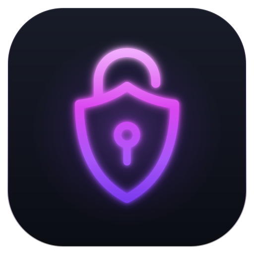

<div align="center">



# Pass-Vault

**Zero-Knowledge Password, PIN, Card & Secure Note Manager**

Built with a Deep Obsidian (`#09090B`) & Electric Purple (`#8B5CF6`) design system across a **Native Android APK**, **Responsive Web App**, and **Manifest V3 Browser Extension**.

<p>
  <a href="https://pass-vault-mhel.vercel.app/Pass-Vault.apk">
    
  </a>
  <a href="https://pass-vault-mhel.vercel.app">
    
  </a>
</p>

<p>
  
  
  
  
</p>

[Features](#-features--capabilities) • [Architecture](#-architecture) • [Quick Start](#-quick-start) • [Release Notes](#-release-notes) • [Blueprint](./BLUEPRINT.md)

</div>

---

> [!IMPORTANT]
> **Zero-Knowledge Guarantee:** Master Passwords, Vault Encryption Keys (`VEK`), and plaintext secrets never leave your device. Only authenticated `AES-256-GCM` ciphertext blobs are synced.

---

## ✨ Features & Capabilities

### 🔐 Zero-Knowledge Security & Encryption
| Capability | Details |
| :--- | :--- |
| **Client-Side Cryptography** | `Argon2id` (with `PBKDF2-SHA256` fallback), `HKDF-SHA256` subkey splitting, wrapped `VEK`, and `AES-256-GCM` with 96-bit IVs & AAD binding. |
| **Multi-Mode Unlock** | Master Password, 6-digit Quick-Unlock PIN, and native Android **Fingerprint & Face Unlock** (`BiometricPrompt` + `AndroidKeyStore` AES-256-GCM in the APK). |
| **5-Strike PIN Wipe** | Automatically wipes locally wrapped unlock keys after 5 failed PIN attempts, falling back safely to Master Password recovery. |
| **Auto-Lock & Clipboard Clear** | Configurable idle/background auto-lock (`Immediate`, `1m`, `2m`, `5m`) and a 30-second clipboard auto-clear countdown after copying secrets. |

### 🗂️ Vault Item Types & Organization
- **Logins:** Email, Username, optional **ID**, optional **PIN**, masked Password with eye toggle & typing feedback, Website URLs, Notes, and **Password History** (tracks up to 10 previous passwords with **Clear History** & per-entry delete).
- **PINs & Passcodes:** Dedicated **PIN** and **Passcode** fields (either or both; optional for `SIM / PUK`), category tags (`Bank / ATM / E-Wallet`, `Device / Phone`, `SIM / PUK`, `Door / Alarm`, `Gov / Work ID`, `Other`), and associated account/device.
- **Payment Cards:** Cardholder name, card number, brand, expiry, masked CVV & Card PIN, and billing ZIP.
- **Secure Notes & 2FA:** Optional **ID**, encrypted note content, and interactive **One-Time Recovery Codes** checklist.
- **Smart Sorting & `#tag` Search:** Favorites-first, oldest-to-newest sorting, instant keyword & `#tag` filtering in the search bar, clickable `#tag` badges, and `Ctrl/Cmd + K` Quick Search.

### 📱 Cross-Platform Experience
- **Desktop Web App:** 3-pane workspace with a collapsible sidebar (shrinks to a minimal Shield + Search rail), hover-resizable pane dividers, and persisted `localStorage` widths.
- **Native Android APK:** Capacitor-wrapped app (`com.mhelric.passvault`) signed with a persistent release keystore for seamless in-place updates, native status-bar safe-area spacing, hardware Back-button **Close Pass-Vault?** confirmation, and automatic startup **Update Available** checks.
- **Mobile Web App:** Fixed glassmorphic bottom navigation bar, slide-up detail inspector, and clean non-scrolling short lists.
- **Companion Extension (`apps/extension`):** Manifest V3 browser extension with active-tab domain matching and one-click form autofill.

### 🛠️ Tools, Sync & Backups
- **Offline-First Cloud Sync:** Local `Dexie.js` IndexedDB storage with encrypted delta sync to Supabase across devices.
- **CSPRNG Generator:** Strong password, passphrase, and numeric PIN generator with one-click copy or direct vault item creation.
- **Smart Importer:** Parses `.txt` credential lists and Google Keep notes into a staging inbox before encrypting into your vault.
- **Offline Vault Health Audit:** Collapsible **Scan / Details** audit in Settings that detects weak or reused secrets strictly in RAM.
- **Encrypted `.vault` Backups:** Export and restore standalone password-protected `.vault` backup files offline.

---

## 🧩 Architecture

| Package | Role | Highlights |
| :--- | :--- | :--- |
| **`packages/crypto`** (`@vault/crypto`) | Cryptographic Core | `Argon2id`, `PBKDF2-SHA256`, `HKDF-SHA256`, `AES-256-GCM`, CSPRNG generator, byte zeroization |
| **`packages/core`** (`@vault/core`) | Vault Engine | Typed schemas, `Dexie.js` DB, 5-strike wipe, delta sync, `.txt`/Keep importer, `.vault` backup |
| **`packages/ui`** (`@vault/ui`) | Design System | Deep Obsidian + Electric Purple tokens, `PinKeypad`, `SecretDisplay`, `SecretInput`, `CopyButton` |
| **`apps/pwa`** (`@vault/pwa`) | Web App & Android APK | React 19 UI, Capacitor Android bridge (`BiometricBridgePlugin.java`), Supabase sync |
| **`apps/extension`** (`@vault/extension`) | Browser Companion | Manifest V3 popup, domain matcher, one-click autofill |

---

## 🚀 Quick Start

```bash
npm install
npm run typecheck
npm test
npm run dev
```

Open `http://localhost:5173` to sign in or create your encrypted Pass-Vault account. Configure `.env` from `.env.example` and apply `supabase/migrations/202611150001_init_vault.sql` to enable Supabase cloud sync across devices.

### Production Build & Extension Loading

```bash
npm run build
```

- **Web Deploy (`apps/pwa/dist`):** Deploy `apps/pwa` to Vercel (via `apps/pwa/vercel.json`) or Cloudflare Pages.
- **Android APK:** Automatically built and signed on push via `.github/workflows/android-apk.yml`.
- **Browser Extension (`apps/extension/dist`):** Open `chrome://extensions`, enable **Developer mode**, and click **Load unpacked** pointing to `apps/extension/dist`.

---

## 📋 Release Notes

### 🟣 Latest — `v1.0.18`
- Styled the Sign In card with translucent dark glassmorphism (`bg-[#12121a]/55`, `backdrop-blur-xl`, subtle top highlight) so the animated background GIFs glow softly through.

<details>
<summary><strong>Previous Releases (v1.0.1 – v1.0.17)</strong></summary>

#### `v1.0.17`
- Expanded Sign In background to **8** Destockd security, vault, and cyber GIFs (`signin-bg.gif` through `signin-bg-8.gif`), synced to a 3-second single-play crossfade cycle so each GIF plays once before advancing.

#### `v1.0.16`
- Added 3 more Destockd vault/cyber background GIFs (`signin-bg-2.gif`, `signin-bg-3.gif`, `signin-bg-4.gif`) with a smooth 5-second crossfade rotation on the Sign In page.

#### `v1.0.15`
- Cropped, brightened, and full-bleed scaled the Sign In background GIF (`signin-bg.gif`) so it fills the entire viewport clearly.

#### `v1.0.14`
- Added an archival cyber/mainframe background GIF (`signin-bg.gif` sourced from Destockd) exclusively on the Sign In page with a Deep Obsidian + Electric Purple scrim.

#### `v1.0.13`
- Hid **FaceID / Fingerprint Unlock** settings and lock-screen trigger on the web app (shown in the native Android APK only).
- Added a **Scan / Details** expander toggle to **Offline Vault Health** in Settings (collapsed by default).
- Removed the redundant **Install Web App** button, leaving the direct **Download APK** button on the website.
- Centered the **Fingerprint** unlock button directly below `0` and above **Unlock with Master Password instead** with balanced spacing.

#### `v1.0.12`
- Made **PIN** and **Passcode** optional when **PIN Category** is set to `SIM / PUK`.

#### `v1.0.11`
- Removed bottom-left sidebar and mobile tag chip clutter; added `#tag` search support directly inside the **Filter items or #tags…** search bar.

#### `v1.0.10`
- Added an optional **PIN** field to **Login** vault items.

#### `v1.0.9`
- Added `#tag` filtering support and clickable item tag badges.

#### `v1.0.8`
- Added dedicated **PIN** and **Passcode** fields for PIN vault items (supporting either or both).

#### `v1.0.7`
- Added **Clear History** and per-entry delete buttons to **Password History** on Login items.

#### `v1.0.6`
- Added an optional **ID** field (`accountId`) for **Login** and **Note** items.
- Updated Vault sorting to prioritize **Favorites** at the top, followed by items ordered **oldest to newest**.

#### `v1.0.5`
- Switched Android APK builds to persistent release keystore signing for seamless in-place future updates without package conflicts.

#### `v1.0.4`
- Fixed the blank gap above the Android keyboard when typing by removing duplicate `IME` inset padding in `MainActivity.java`.

#### `v1.0.3`
- Implemented native Android **Fingerprint & Face Unlock** (`androidx.biometric.BiometricPrompt` + `AndroidKeyStore` AES-256-GCM).

#### `v1.0.2`
- Fixed Android status bar / clock overlap via native window inset padding.
- Refined Lock Screen vertical alignment for both PIN keypad and Master Password modes.

#### `v1.0.1`
- Added startup update check and **Update Available** popup using `version.json`.
- Added Capacitor Android APK wrapper, custom Pass-Vault Shield launcher icon, and native hardware Back-button exit confirmation.

</details>
